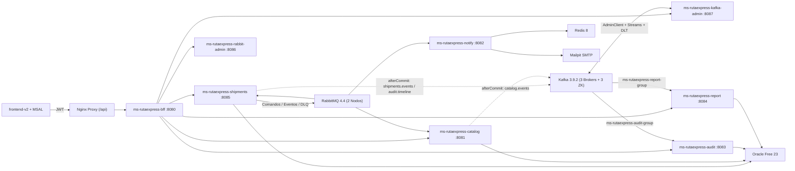

# RutaExpress

Plataforma Cloud-Native de gestión de envíos de última milla (Caso 3 — DSY1107). Integra **orquestación asíncrona sobre RabbitMQ** (reservas de capacidad, compensaciones, notificaciones por correo/PDF y colas de errores DLQ) con **event streaming y analítica en tiempo real sobre Apache Kafka** (eventos de dominio, auditoría histórica, métricas/KPIs, Kafka Streams y administración de clúster), bajo seguridad **OAuth2/JWT con Microsoft Entra ID** y la consola operativa **frontend-v2**.

---

## Cómo funciona el proyecto

1. **Acceso y seguridad (`frontend-v2` + Entra ID + BFF)**:
   - El usuario inicia sesión en **frontend-v2** (`http://localhost:4200`) mediante **Microsoft Entra ID (MSAL)** obteniendo un *access token* JWT con los roles asignados (`ADMIN`, `DESPACHADOR`, `CLIENTE`, `AUDITOR`).
   - El servidor Nginx de `frontend-v2` expone la consola y actúa como proxy inverso de `/api/` hacia **ms-rutaexpress-bff**.
   - El **BFF** y los **7 microservicios internos** validan firma, *issuer*, *audience* y vigencia del JWT, aplicando autorización granular por rol (`CLIENTE` solo accede a sus propios envíos por `oid`; `ADMIN` opera catálogo, reportes y administración de RabbitMQ y Kafka).
2. **Ciclo de vida de envíos y coordinación RabbitMQ (EP2)**:
   - Al crear o aceptar un envío (`ms-rutaexpress-shipments`), se persiste en **Oracle** y se envía el comando `capacity.reserve` al exchange *direct* `ex.rutaexpress.cmd` de **RabbitMQ**.
   - `ms-rutaexpress-catalog` consume `q.rutaexpress.command`, valida e intenta reservar cupo por zona/vehículo de forma idempotente (`commandId` + clave única por `shipmentId`), y responde con eventos `catalog.capacity.reserved` / `rejected` / `released` en `ex.rutaexpress.events`.
   - `ms-rutaexpress-notify` consume `q.rutaexpress.notification`, deduplica en **Redis** y envía correos/PDF (OpenPDF) vía SMTP (**Mailpit** en local).
   - Todos los consumidores AMQP usan **ACK manual**, reintentos acotados y **NACK sin reencolar** hacia su **DLQ** (`q.rutaexpress.*.dlq`) con registro en logs.
3. **Streaming de eventos y analítica con Apache Kafka (EP5)**:
   - Después de confirmar la transacción en Oracle (`afterCommit`), `ms-rutaexpress-shipments` y `ms-rutaexpress-catalog` publican eventos de dominio de forma asíncrona (con `batch.size=32768`, `linger.ms=20`, `snappy`, `enable.idempotence=true` y cabeceras `X-Correlation-Id`, `X-Trace-Id`, `X-Event-Id`) en **`shipments.events`**, **`audit.timeline`** y **`catalog.events`**.
   - **`ms-rutaexpress-audit`** (`ms-rutaexpress-audit-group`, `concurrency=3`, `CooperativeStickyAssignor`) consume los tres tópicos y persiste una traza inmutable en Oracle usando `PROCESSED_MESSAGES` para idempotencia.
   - **`ms-rutaexpress-report`** (`ms-rutaexpress-report-group`) consume `shipments.events`, actualiza snapshots analíticos en Oracle (idempotencia por `last_event_id` + timestamp), invalida la caché Caffeine e informa KPIs y servicios más demandados.
   - **`ms-rutaexpress-kafka-admin`** ejecuta una topología **Kafka Streams** (`rutaexpress-streams-processor`) sobre `shipments.events` (*map, filter, branch, count, reduce*, ventanas Tumbling/Hopping), además de administrar tópicos, configuraciones, consumer groups (incluyendo *reset-offsets* y borrado de grupos inactivos), pruebas de carga (`sensor-topic` / `analytics-group`) y manejo/reprocesamiento DLT (`ordenes-creadas` / `.DLT`). Justificación completa: [arquitectura Kafka EP5](infra/kafka/README.md).



---

## Componentes

| Carpeta | Responsabilidad | Puerto interno |
|---|---|---|
| `frontend-v2` | Consola operativa HTML/JS + Tailwind v4 + MSAL + proxy Nginx (interfaz activa en `compose.yaml`) | `8080` (`4200` en host) |
| `frontend` | Aplicación Angular 19 alternativa (validada en CI; usada con `infra/scripts/up.sh --dev` o `infra/edge`) | `8080` |
| `ms-rutaexpress-bff` | Gateway interno/BFF: validación JWT, roles, agregación y proxy autenticado | `8080` |
| `ms-rutaexpress-catalog` | Servicios, tarifas, capacidad por zona/vehículo, consumidor AMQP y productor `catalog.events` | `8081` |
| `ms-rutaexpress-notify` | Notificaciones email/PDF (OpenPDF) desde RabbitMQ con idempotencia en Redis | `8082` |
| `ms-rutaexpress-audit` | Consumidor Kafka (`shipments.events`, `audit.timeline`, `catalog.events`) y API de auditoría | `8083` |
| `ms-rutaexpress-report` | Consumidor Kafka (`shipments.events`), proyecciones KPI en Oracle, caché Caffeine y DLT | `8084` |
| `ms-rutaexpress-shipments` | Gestión de envíos, reconciliación AMQP y productor post-commit Kafka | `8085` |
| `ms-rutaexpress-rabbit-admin` | Administración REST del clúster RabbitMQ (colas, exchanges, bindings, retención y DLQ) | `8086` |
| `ms-rutaexpress-kafka-admin` | Administración Kafka (tópicos/configs/consumer groups), Kafka Streams, Load Tester y DLT | `8087` |
| `infra` | Infraestructura modular por capas (`mq`, `kafka`, `apps`, `edge`, `vps`) y scripts operativos | Solo Caddy publica `80`/`443` |

---

## Tecnologías del proyecto

| Capa | Tecnologías y versiones |
|---|---|
| **Frontend activo (`frontend-v2`)** | HTML5, JavaScript (ES5/ES6 sin framework), Tailwind CSS v4, Tabler Icons 3.2.0, `@azure/msal-browser` 5.21.0, Nginx (`nginxinc/nginx-unprivileged:alpine`), `node:22-alpine` (`node --test`) |
| **Frontend alternativo (`frontend`)** | Angular 19, MSAL Angular, Karma/Chromium |
| **Backend (8 microservicios)** | Kotlin 2.3.21, JVM 21, Spring Boot 4.1.1, Gradle Wrapper 9.7.1, Jackson 3 (`tools.jackson.*`), Spring Security OAuth2 Resource Server (JWT Entra ID), Spring Data JPA / Hibernate, Spring Validation (JSR-380), Caffeine Cache, Springdoc OpenAPI / Swagger UI 3.1.1, Actuator + Micrometer Prometheus, OpenPDF |
| **Mensajería y Streaming** | RabbitMQ 4.4 (clúster de 2 nodos con Erlang Cookie), Apache Kafka 3.9.2 (3 brokers), Apache ZooKeeper 3.9 (3 nodos), Kafka Streams, Kafka UI v0.7.2 |
| **Bases de datos y Caché** | Oracle Database Free 23 (`gvenzl/oracle-free:23-slim`), Flyway (`flyway-core` + `flyway-database-oracle`), H2 (en memoria para perfil `local` y unit tests), Redis 8 Alpine |
| **Correos y Contenedores** | Mailpit v1.27 (SMTP + UI web), Docker, Docker Compose, Caddy 2 |
| **CI/CD y Pruebas** | GitHub Actions, Testcontainers (Oracle Free + Kafka + RabbitMQ), JaCoCo 0.8.13, Playwright, Python gates (`ci/policy.py`, `ci/gate.py`, `ci/compose_contract.py`) |

---

## Cómo levantarlo de forma local

### Opción 1 (Recomendada): Stack completo con Docker Compose desde la raíz

No requiere instalar JDK, Gradle, Node ni Oracle en tu equipo. Desde la raíz del repositorio con **Docker Desktop** (en modo contenedores Linux y con al menos **16 GiB de RAM** asignados a Docker):

```sh
docker compose up --build
```

O en segundo plano esperando que los 19 contenedores estén saludables:

```sh
docker compose up -d --build --wait --wait-timeout 600
```

> [!NOTE]
> El Compose raíz usa valores públicos predeterminados de Microsoft Entra ID y credenciales locales listas para desarrollo (no requiere crear `.env`). El login con Entra ID y los recursos CDN de `frontend-v2` requieren conexión a internet y la URI `http://localhost:4200` registrada como SPA. Si deseas personalizar puertos o credenciales antes del primer arranque, copia `.env.example` a `.env` en la raíz.

#### Accesos locales

| Servicio | URL / Puerto | Notas |
|---|---|---|
| **Consola operativa (`frontend-v2`)** | http://localhost:4200 | Punto de entrada principal; Nginx proxea `/api/` al BFF |
| **Kafka UI** | http://localhost:8090 | Visualización de 3 brokers, 3 ZooKeeper, tópicos y consumer groups |
| **RabbitMQ Management (Nodo 1 / 2)** | http://localhost:15672 / http://localhost:15673 | Usuario: `ruta_local` · Contraseña: `RutaLocalRabbit2026` |
| **Mailpit (correos salientes)** | http://localhost:8025 | Bandeja de correos y etiquetas/tickets PDF generados por `notify` |
| **Kafka Admin directo (solo loopback)** | http://127.0.0.1:8087 (y `8888`) | Protegido por JWT (`ROLE_ADMIN`) |

#### Comandos útiles en local

```sh
# Ver estado de contenedores y logs en vivo
docker compose ps
docker compose logs -f

# Inicializar o verificar tópicos Kafka y consumer groups por CLI
bash infra/kafka/kafka-ops.sh init-topics
bash infra/kafka/kafka-ops.sh list-topics
bash infra/kafka/kafka-ops.sh list-groups

# Verificar estado del clúster RabbitMQ
docker compose exec rabbit1 rabbitmqctl cluster_status

# Detener conservando volúmenes (Oracle, Kafka, RabbitMQ, Redis)
docker compose down

# Detener eliminando datos y reiniciar desde cero
docker compose down -v
```

Más detalles de operación, puertos, credenciales y matriz de roles en [guía local](infra/LOCAL.md).

### Opción 2: Pruebas locales integradas con emisor JWT de prueba (`smoke.py`)

Para probar el flujo HTTP completo (roles, reserva RabbitMQ, Mailpit, auditoría Kafka y reportes) sin depender de cuentas interactivas de Entra ID:

```sh
docker compose -f compose.yaml -f tests/local/compose.jwt.yml up -d --build --wait --wait-timeout 600
python3 tests/local/smoke.py
# Restaurar Entra ID:
docker compose up -d --wait --wait-timeout 600 --remove-orphans
```

### Opción 3: Ejecutar un microservicio individual con Gradle (perfil `local`)

Si ya levantaste la infraestructura de brokers (`infra/mq` y `infra/kafka`) o quieres probar solo la capa HTTP/H2 en memoria de un microservicio específico (requiere JDK 21):

```sh
cd ms-rutaexpress-audit   # o el microservicio deseado
export SECURITY_ENABLED=false
export SPRING_PROFILES_ACTIVE=local
./gradlew bootRun
```

Consulta el `README.md` dentro de cada carpeta `ms-rutaexpress-*` para ver sus variables, puertos y comandos exactos.

---

## Construcción, pruebas y despliegue

- **CI/CD en GitHub Actions**: En cada `push` y `pull_request` ejecuta políticas (`ci/policy.py`, `ci/compose_contract.py`), las 8 suites Gradle con Testcontainers y cobertura JaCoCo (`ci/gate.py`), tests de `frontend-v2` (`node --test`), Karma/Chromium de Angular y pruebas E2E con Playwright. Solo publica en GHCR tras aprobar el quality gate global ([ci/README.md](ci/README.md)).
- **Despliegue por capas en EC2**: Configurar `infra/.env` a partir de `infra/.env.example` y ejecutar `bash infra/scripts/up.sh` y `bash infra/scripts/status.sh` ([infra/README.md](infra/README.md)).
- **Despliegue VPS (EP2 sin frontend)**: `bash deploy-vps.sh` levanta RabbitMQ, Oracle, Redis, Mailpit y los 5 microservicios EP2 según `infra/vps/compose.yml`.
- **Modo local anterior con Angular**: `bash infra/scripts/up.sh --dev` levanta el frontend Angular en `http://localhost:4200` contra el BFF en `http://localhost:8080` ([frontend/README.md](frontend/README.md)).
- **Migraciones Flyway**: Nunca modificar migraciones ya publicadas (`V1`..`V5` en `shipments`, `V1`..`V4` en `catalog`, `V1`..`V3` en `audit`, `V1`..`V2` en `report`); todo cambio de esquema debe agregarse en una nueva migración incremental.

---

## Autores

Equipo RutaExpress ([Henisaa/Proyecto-cloud-native](https://github.com/Henisaa/Proyecto-cloud-native)).
