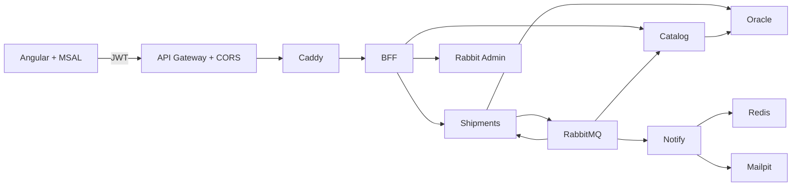

# RutaExpress

Plataforma de envíos de última milla del Caso 3. La EP2 incorpora reservas de capacidad asíncronas, notificaciones y auditoría sobre RabbitMQ, con un administrador REST y frontend Angular por rol.



## Componentes

| Carpeta | Responsabilidad | Puerto interno |
|---|---|---|
| frontend | Angular 19, MSAL, envíos, catálogo y administración de colas | 8080 |
| ms-rutaexpress-bff | JWT, roles, agregación y proxy del dominio | 8080 |
| ms-rutaexpress-catalog | Servicios, tarifas y reservas de capacidad | 8081 |
| ms-rutaexpress-notify | Correos y PDF desde RabbitMQ | 8082 |
| ms-rutaexpress-audit | Auditoría Kafka (EP1 opcional) | 8083 |
| ms-rutaexpress-report | KPIs Kafka (EP1 opcional) | 8084 |
| ms-rutaexpress-shipments | Envíos y coordinación asíncrona | 8085 |
| ms-rutaexpress-rabbit-admin | Clúster, colas, exchanges, bindings, retención y métricas | 8086 |
| ms-rutaexpress-kafka-admin | Administración Kafka (EP1 opcional) | 8087 |
| infra | Compose por capas: mq, apps, kafka y edge | Solo Caddy publica 80/443 |

Kotlin 2.3.21, JVM 21, Spring Boot 4.1.1, Gradle Wrapper 9.7.1, Jackson 3, Oracle/JPA/Flyway, RabbitMQ 4, Kafka 3.9.2/ZooKeeper, Redis y Mailpit.

## Construcción, pruebas y ejecución

GitHub Actions construye las imágenes Docker, ejecuta sus pruebas y publica en GHCR con etiqueta `sha-<commit corto>`. El frontend ejecuta Karma/Chromium y build de producción dentro de Docker; el CI comprueba también el contenedor servido. Las integraciones usan Testcontainers (broker, Redis y migraciones Oracle). No instalar JDK, Gradle ni Node en el PC.

En EC2, configurar `infra/.env` a partir de su ejemplo y ejecutar:

```sh
bash infra/scripts/up.sh
bash infra/scripts/status.sh
```

Detalles y variables: [infra/README.md](infra/README.md). Interfaz y roles: [frontend/README.md](frontend/README.md). Aceptación HTTP y evidencia manual: [infra/acceptance/README.md](infra/acceptance/README.md).

## Mensajería y seguridad

Tres colas funcionales: command, notification y audit; cada una tiene su DLQ. Comandos por exchange direct, eventos por topic, ACK manual, reintentos acotados, NACK sin reencolar y registro de DLQ. El frontend muestra PENDIENTE → RESERVADA/RECHAZADA, permite reintento y visualiza la compensación. Catalog deduplica por commandId y reserva por shipmentId, con bloqueo y clave única.

MSAL obtiene el access token. Gateway y BFF validan JWT; el BFF aplica roles y conserva Bearer. Cliente solo consulta envíos de su oid. Solo Admin administra RabbitMQ. No exponer servicios internos ni desactivar seguridad en nube. La coordinación entre base y RabbitMQ usa confirmaciones y reconciliación; outbox sigue como mejora prevista en el plan.

## Estado de la EP2

[PLAN_CORRECCIONES_EP2.md](PLAN_CORRECCIONES_EP2.md) es la especificación de trabajo. CI verde certifica exclusivamente las comprobaciones automatizadas del commit correspondiente: no prueba el tenant, DNS, Gateway ni EC2. El cierre requiere las 14 pruebas de aceptación reales, recorrido de los cuatro roles y usuario sin rol, y repositorios separados tras integrar main. No se afirma que esas etapas externas estén completadas.

Detalle de implementación y pendientes: [SEGUIMIENTO_EP2.md](SEGUIMIENTO_EP2.md).

La migración V2 de shipments conserva su definición original; V3 amplía event_id a 100 y V4 agrega versión, dueño e identificador de reserva. No editar migraciones publicadas.

## Autores

Equipo RutaExpress (Henisaa/Proyecto-cloud-native).
