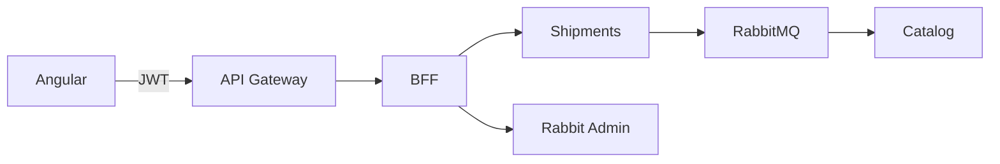

# Frontend RutaExpress

Angular 19 y MSAL. La interfaz muestra el resultado asíncrono de reservas de capacidad y administra RabbitMQ mediante el BFF; todas las llamadas pasan por el API Gateway.



## Pantallas y roles

| Ruta | Roles |
|---|---|
| `/` | Login público con Entra ID |
| `/dashboard` | Admin, Despachador, Cliente, Auditor |
| `/shipments`, `/shipments/:id` | Admin, Despachador, Cliente |
| `/shipments/new` | Admin, Despachador, Cliente |
| `/catalog` | Admin, Despachador |
| `/reports`, `/admin/mq`, `/admin/kafka`, `/admin/session` | Admin |
| `/audit` | Admin, Auditor |

Cliente solo ve sus envíos (el backend filtra por `oid`). Las capacidades del catálogo se muestran a Admin y Despachador; solo Admin edita. Las acciones usan `allowedTransitions` del backend. Roles, rutas y menú comparten la normalización de `core/roles.ts`; los guards cargan los roles del access token de la API, sin conceder permisos a partir del ID token. Cliente conserva la selección de servicios para crear un envío. El timeline es exclusivo de Admin y Auditor.

## Mensajería visible

El navegador no se conecta directamente al broker. Aceptar muestra PENDIENTE; consulta cada 3 segundos hasta RESERVADA o RECHAZADA, durante un máximo de 30 segundos. La cancelación y LIBERACION_PENDIENTE también se reflejan en detalle y listado. Salir de la vista cancela el sondeo. La línea de tiempo identifica eventos de RabbitMQ y Kafka.

En `/admin/mq`, pestaña Colas, se visualizan listos, sin confirmar, consumidores, política, DLX y recursos protegidos. Hay creación y eliminación de colas, exchanges y bindings, políticas de retención y publicación de prueba. Las confirmaciones previas se conservan si una publicación posterior falla. Esta visualización usa las tres colas funcionales existentes y sus DLQ.

## Variables de entorno

El contenedor genera `/config.json` al arrancar:

| Variable | Uso |
|---|---|
| `API_BASE_URL` | Origen HTTPS del Gateway |
| `MSAL_CLIENT_ID`, `MSAL_AUTHORITY` | Registro SPA y tenant |
| `MSAL_REDIRECT_URI` | Origen de la aplicación registrado en Entra ID |
| `MSAL_SCOPE` | Scope `access_as_user` |
| `MSAL_POST_LOGOUT_REDIRECT_URI` | Opcional; por defecto la URI de redirección |
| `ENVIRONMENT_NAME` | Distintivo del entorno |

No contiene secretos ni tokens. La configuración se carga antes de inicializar MSAL, incluso al abrir una ruta interna directamente. Solo MsalInterceptor adjunta el access token. Caché de sesión: sessionStorage. No hay bypass de autenticación de producción.

## Construcción y pruebas en Docker

Las ejecuta GitHub Actions; no instalar Node ni Chromium en el PC.

```sh
docker build -t frontend-rutaexpress:test frontend
docker build --target reports --output type=local,dest=reports/frontend frontend
```

El build ejecuta Karma con Chromium antes del build de producción; si una prueba falla, no hay imagen. Pruebas: AuthService, roles y guard, errores, rutas HTTP y filtros, sondeo y límite temporal, recuperación del listado tras fallar, acciones por rol y doble clic, validadores del administrador y publicación con cola llena.

## Ejecución

En EC2: `bash infra/scripts/up.sh`. `infra/edge/compose.yml` sirve la imagen por Caddy. nginx corre sin privilegios en 8080, con fallback SPA, gzip, CSP, cabeceras de seguridad y configuración sin caché. Producción usa el Gateway, sin proxy directo al BFF. Para desarrollo en Codespaces, `proxy.conf.json` reescribe `/api/admin` a `/api/bff/admin`.

## Decisiones y alcance de verificación

Los guards organizan la interfaz; la autorización real se aplica otra vez en BFF y microservicios. Los errores HTTP se traducen centralmente y se muestran en avisos. Las pruebas automatizadas en CI no sustituyen el recorrido con los cinco usuarios reales ni las 14 pruebas de aceptación en nube del plan.

## Autores

Equipo RutaExpress (repositorio Henisaa/Proyecto-cloud-native).