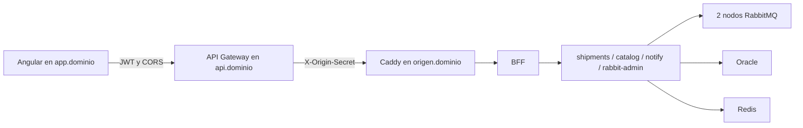

# Infraestructura RutaExpress

Ejecución en EC2 con Docker Engine y Compose v2. GitHub Actions construye y prueba las imágenes y las publica en GHCR; el EC2 solo las descarga. No se instala JDK, Gradle, Node ni bases de datos en el PC.



## Acceso y roles

Solo Caddy publica 80/443. BFF y microservicios no publican puertos. Gestión RabbitMQ (15672/15673), Mailpit (8025) y Kafka UI (8090) se consultan por túnel SSH. API Gateway valida JWT, configura CORS y enruta `/api/admin/*` a `/api/bff/admin/*`; BFF y servicios vuelven a validar JWT y roles. Administración: solo Admin.

## Mensajes

`ex.rutaexpress.cmd` direct entrega `capacity.reserve` y `capacity.release` a command. `ex.rutaexpress.events` topic entrega notificaciones y eventos de auditoría a notification y audit. Cada cola tiene DLQ con `x-death` y listener de logs; ACK manual, reintentos acotados y NACK sin reencolar. Las colas clásicas son durables, pero no se replican por estar en un clúster de dos nodos.

## Variables y secretos

Copiar `infra/.env.example` a `infra/.env` y completar los valores en EC2 con permisos 600. Nunca versionar el archivo real. La cookie se genera con `bash infra/scripts/init-secrets.sh` y no se reemplaza si ya existe.

- `REGISTRY`, `IMAGE_TAG` y etiquetas específicas: imágenes de GHCR. El CI publica etiquetas `sha-<commit corto>`; usar ese prefijo completo al fijar una versión.
- `SECURITY_ENABLED=true`, emisor y audiencia de Entra ID.
- `RABBITMQ_USERNAME`, `RABBITMQ_PASSWORD` propios, sin credenciales de desarrollo.
- `ORACLE_ADMIN_PASSWORD` y una contraseña por esquema: `SHIPMENTS_DB_PASSWORD`, `CATALOG_DB_PASSWORD`, `AUDIT_DB_PASSWORD`, `REPORT_DB_PASSWORD`.
- `APP_DOMAIN`, `ORIGIN_DOMAIN`, `ORIGIN_SECRET`, `ACME_EMAIL`, `FRONTEND_API_BASE_URL`, `MSAL_REDIRECT_URI`.
- `KAFKA_ENABLED=false` por defecto. Para EP1 completa: true y `COMPOSE_PROFILES=ep1`, con memoria suficiente.

Oracle crea usuarios en FREEPDB1 mediante `apps/oracle-init/001-users.sh` únicamente al inicializar un volumen vacío. Cambiar variables no cambia contraseñas de usuarios existentes. Para base gestionada, configurar DB_URL y retirar la dependencia de Oracle local mediante un override específico del entorno.

## Construir y probar

Las pruebas se ejecutan dentro de las imágenes en Actions. El job de integración usa Docker/Testcontainers para RabbitMQ, Redis y migraciones Oracle; no requiere instalar herramientas en el PC. El job compose valida las cuatro capas y los overrides de desarrollo.

```sh
docker compose --env-file infra/.env -f infra/apps/compose.yml config -q
docker compose --env-file infra/.env -f infra/mq/compose.yml config -q
docker compose --env-file infra/.env -f infra/kafka/compose.yml config -q
docker compose --env-file infra/.env -f infra/edge/compose.yml config -q
```

## Ejecutar en EC2

```sh
bash infra/scripts/up.sh
bash infra/scripts/status.sh
docker compose --env-file infra/.env -f infra/mq/compose.yml exec rabbit1 rabbitmqctl cluster_status
```

Arranque: red compartida, cookie, RabbitMQ healthy, Kafka si EP1 está activa, datos/aplicaciones, frontend y Caddy. Compose aplica reinicio automático, límites de memoria y rotación de logs. Se recomienda EC2 de 16 GiB con Kafka; el presupuesto completo está en el plan. `bash infra/scripts/down.sh` detiene sin borrar volúmenes.

Para Docker Desktop o Codespaces, `bash infra/scripts/up.sh --dev` usa los overrides que construyen imágenes y publican puertos locales; no usar esos overrides en EC2 público.

## Decisiones y aceptación

El archivo mq/definitions.json aplica políticas desde el arranque y rabbit-admin las reconcilia: trabajo (TTL 24 h, máximo 10.000, reject-publish), DLQ (TTL 7 días, máximo 10.000, drop-head). El acumulado de DLQ se reinicia con las estadísticas del nodo; no equivale a una métrica histórica persistente.

Después del despliegue ejecutar las 14 pruebas de la sección 13.2 del plan y guardar HTTP, capturas y logs: JWT/CORS, cinco usuarios, capacidad asíncrona, tres consumidores, errores y DLQ, creación/eliminación, límites y TTL. CI verde valida imágenes y pruebas automatizadas; no certifica DNS, Entra ID, Gateway ni EC2.

## Autores

Equipo RutaExpress (repositorio Henisaa/Proyecto-cloud-native).