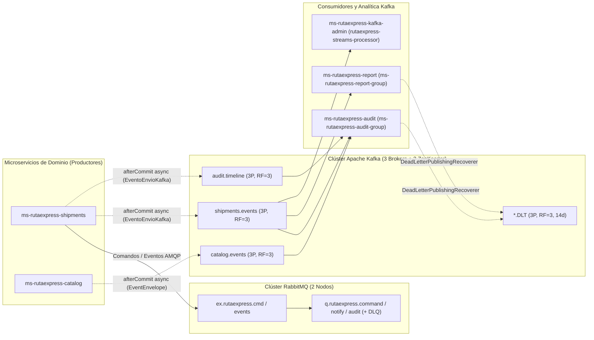

# Arquitectura de Streaming y Analítica con Apache Kafka (EP5)

Este documento describe y justifica el diseño de la plataforma de streaming **Apache Kafka** en **RutaExpress**, su coexistencia sin interferencia con **RabbitMQ**, la parametrización de tópicos por flujo de datos, la estrategia de **Consumer Groups**, el manejo de errores con **Dead Letter Topics (`.DLT`)** y las herramientas de administración replicables.

---

## 1. Justificación del Diseño: ¿Cómo Kafka complementa a RabbitMQ sin afectarlo?

RutaExpress separa estrictamente la **mensajería transaccional de comandos/notificaciones** (RabbitMQ) del **streaming de eventos de dominio y analítica en tiempo real** (Apache Kafka):

| Dimensión | RabbitMQ (Coordinación Operativa — EP2/EP4) | Apache Kafka (Streaming y Analítica — EP5) |
|---|---|---|
| **Propósito en RutaExpress** | Comandos punto a punto (`capacity.reserve`, `capacity.release`), resultados de reserva, notificaciones por correo/PDF y auditoría operativa inmediata. | Registro distribuido inmutable de eventos de dominio (`shipments.events`, `audit.timeline`, `catalog.events`), KPIs agregados, Kafka Streams con ventanas de tiempo y trazabilidad histórica. |
| **Modelo de consumo** | Cola competitiva con borrado al confirmar (`basicAck` manual). Un mensaje de comando o correo lo procesa un único worker. | Log particionado retenido en disco. Múltiples microservicios (`audit`, `report`, `kafka-streams`) leen **el mismo flujo** de forma independiente con su propio offset. |
| **Acoplamiento transaccional** | Publicación con *Publisher Confirms*, *Returns* y reconciliador periódico (`ReconciliadorCapacidad`) sobre Oracle. | Publicación **desacoplada post-commit** (`TransactionSynchronization.afterCommit`) en un `ThreadPoolExecutor` asíncrono dedicado. |
| **Aislamiento de fallos** | Si RabbitMQ reintenta y agota intentos, hace `basicNack(requeue=false)` hacia `q.rutaexpress.*.dlq`. | Si Kafka estuviera caído o lento, **jamás bloquea una transacción HTTP ni retrasa un comando de RabbitMQ**. |



---

## 2. Diseño de Tópicos y Parámetros de Administración por Flujo de Datos

El clúster se despliega con **3 nodos ZooKeeper** (`zookeeper-1..3`) y **3 brokers Kafka 3.9.2** (`kafka-1..3`) con `auto.create.topics.enable=false`, `default.replication.factor=3` y `min.insync.replicas=2` para garantizar tolerancia a la caída de un broker sin pérdida de mensajes confirmados (`acks=all`).

Cada tópico define parámetros específicos ajustados a la naturaleza de su flujo:

| Tópico | Part. | Réplicas (RF) | `min.insync.replicas` | `retention.ms` | `cleanup.policy` | Justificación del Flujo |
|---|---:|---:|---:|---:|---|---|
| `shipments.events` | 3 | 3 | 2 | `604800000` (7 días) | `delete` | Flujo principal de cambios de estado de envíos. Clave = `shipmentId` para garantizar orden causal por envío dentro de la misma partición. |
| `audit.timeline` | 3 | 3 | 2 | `2592000000` (30 días) | `compact,delete` | Línea de tiempo histórica de auditoría con retención extendida (30 días) y compactación por clave de evento. |
| `catalog.events` | 3 | 3 | 2 | `604800000` (7 días) | `delete` | Eventos de creación/actualización de servicios, tarifas y capacidades del catálogo. Clave = código de servicio / recurso. |
| `shipments.events.audit.DLT` | 3 | 3 | 2 | `1209600000` (14 días) | `delete` | Dead Letter Topic de `audit` para eventos de `shipments.events` que fallan validación o agotan reintentos. |
| `audit.timeline.audit.DLT` | 3 | 3 | 2 | `1209600000` (14 días) | `delete` | Dead Letter Topic de `audit` para `audit.timeline`. |
| `catalog.events.audit.DLT` | 3 | 3 | 2 | `1209600000` (14 días) | `delete` | Dead Letter Topic de `audit` para `catalog.events`. |
| `shipments.events.report.DLT` | 3 | 3 | 2 | `1209600000` (14 días) | `delete` | Dead Letter Topic de `report` para eventos no procesables en el cálculo de KPIs. |
| `shipments.streams.*` | 3 | 3 | 2 | `86400000` (1 día) | `delete` | 6 tópicos derivados por la topología Kafka Streams (`alertas`, `estandar`, `prioritarios`, `por-servicio`, `por-estado`, `total-por-zona`). |
| `sensor-topic` | 3 | 3 | 2 | `300000` (5 min) | `delete` | Tópico efímero de alto volumen para pruebas de carga y medición de *Consumer Lag*. |
| `tutorial-particiones` | 3 | 3 | 2 | `604800000` (7 días) | `delete` | Demostración práctica de distribución Round-Robin (sin key) vs. Sticky Partitioning (hash Murmur2 con key). |
| `ordenes-creadas` / `.DLT` | 3 | 3 | 2 | 7 días / 14 días | `delete` | Laboratorio interactivo de validación JSR-380, *poison pills*, reintentos exponenciales y reprocesamiento desde DLT. |

---

## 3. Productores, Consumidores, DTOs y Separación de Responsabilidades

### Productores
- **`ms-rutaexpress-shipments`** ([KafkaProducerConfig.kt](file:///home/enrique/Documentos/GitHub/Proyecto-cloud-native/ms-rutaexpress-shipments/src/main/kotlin/com/rutaexpress/shipments/configuracion/KafkaProducerConfig.kt), [EnvioEventPublisher.kt](file:///home/enrique/Documentos/GitHub/Proyecto-cloud-native/ms-rutaexpress-shipments/src/main/kotlin/com/rutaexpress/shipments/eventos/EnvioEventPublisher.kt)):
  - Publica el DTO estructurado [EventoEnvioKafka.kt](file:///home/enrique/Documentos/GitHub/Proyecto-cloud-native/ms-rutaexpress-shipments/src/main/kotlin/com/rutaexpress/shipments/eventos/EventoEnvioKafka.kt) serializado con `StringSerializer` (key) y `JacksonJsonSerializer` (`ADD_TYPE_INFO_HEADERS=false`).
  - Tuning de productor: `acks=all`, `enable.idempotence=true`, `retries=3`, `batch.size=32768` (32 KB), `linger.ms=20`, `compression.type=snappy`, `buffer.memory=67108864` (64 MB).
  - Inyecta cabeceras `X-Correlation-Id`, `X-Trace-Id` y `X-Event-Id` para trazabilidad distribuida.
- **`ms-rutaexpress-catalog`** ([KafkaProducerConfig.kt](file:///home/enrique/Documentos/GitHub/Proyecto-cloud-native/ms-rutaexpress-catalog/src/main/kotlin/com/rutaexpress/catalog/config/KafkaProducerConfig.kt), [CatalogEventPublisher.kt](file:///home/enrique/Documentos/GitHub/Proyecto-cloud-native/ms-rutaexpress-catalog/src/main/kotlin/com/rutaexpress/catalog/event/CatalogEventPublisher.kt)):
  - Publica `EventEnvelope<T>` tipado con payloads `ServiceCreatedPayload`, `ServiceUpdatedPayload`, `CapacityUpdatedPayload` y `TariffUpdatedPayload` ([CatalogEvents.kt](file:///home/enrique/Documentos/GitHub/Proyecto-cloud-native/ms-rutaexpress-catalog/src/main/kotlin/com/rutaexpress/catalog/event/CatalogEvents.kt)) hacia `catalog.events` tras el commit de la transacción JPA.

### Consumidores (Separación Mensajería vs. Dominio)
- **`ms-rutaexpress-audit`**:
  - Capa de transporte: [AuditoriaKafkaConsumidor.kt](file:///home/enrique/Documentos/GitHub/Proyecto-cloud-native/ms-rutaexpress-audit/src/main/kotlin/com/rutaexpress/audit/consumidor/AuditoriaKafkaConsumidor.kt) (`@KafkaListener` sobre `shipments.events`, `audit.timeline` y `catalog.events`).
  - Capa de dominio: [AuditoriaEventoServicio.kt](file:///home/enrique/Documentos/GitHub/Proyecto-cloud-native/ms-rutaexpress-audit/src/main/kotlin/com/rutaexpress/audit/servicio/AuditoriaEventoServicio.kt) (`@Service`, `@Transactional`, validación JSR-380, control de idempotencia en tabla `PROCESSED_MESSAGES` y persistencia en `AUDITORIA_EVENTOS`).
- **`ms-rutaexpress-report`**:
  - Capa de transporte: [EnvioEventoConsumidor.kt](file:///home/enrique/Documentos/GitHub/Proyecto-cloud-native/ms-rutaexpress-report/src/main/kotlin/com/rutaexpress/report/consumidor/EnvioEventoConsumidor.kt) (`@KafkaListener` sobre `shipments.events`).
  - Capa de dominio: [ReporteSnapshotServicio.kt](file:///home/enrique/Documentos/GitHub/Proyecto-cloud-native/ms-rutaexpress-report/src/main/kotlin/com/rutaexpress/report/servicio/ReporteSnapshotServicio.kt) (`@Service`, `@Transactional`, validación JSR-380, idempotencia por `lastEventId` y timestamp, cálculo de `leadTimeMinutes` e invalidación `@CacheEvict` de KPIs).

---

## 4. Estrategia de Consumer Groups, Balanceo y Resiliencia

| Consumer Group | Microservicio | Tópicos Consumidos | Concurrencia / Assignor | Rol en la Arquitectura |
|---|---|---|---|---|
| `ms-rutaexpress-audit-group` | `ms-rutaexpress-audit` | `shipments.events`, `audit.timeline`, `catalog.events` | `concurrency=3`, `CooperativeStickyAssignor`, `read_committed`, `auto-commit=false` | Persistencia histórica e idempotente de eventos de negocio y catálogo. 1 hilo por partición. |
| `ms-rutaexpress-report-group` | `ms-rutaexpress-report` | `shipments.events` | `concurrency=3`, `CooperativeStickyAssignor`, `read_committed`, `auto-commit=false` | Construcción independiente de snapshots analíticos y KPIs operacionales en Oracle. |
| `rutaexpress-streams-processor` | `ms-rutaexpress-kafka-admin` | `shipments.events` | Kafka Streams (`StreamsBuilder` + State Stores locales) | Analítica en tiempo real: `map`, `filter`, `split/branch`, `count`, `reduce` por zona y ventanas Tumbling (5m) / Hopping (10m/5m). |
| `analytics-group` | `ms-rutaexpress-kafka-admin` | `sensor-topic` | `concurrency=3`, `max.poll.records=500`, `CooperativeStickyAssignor` | `SlowConsumer` con retardo controlado (10 ms/msg) para observar y medir *Consumer Lag* bajo ráfagas de carga. |
| `error-handling-group` / `dlt-audit-group` | `ms-rutaexpress-kafka-admin` | `ordenes-creadas` / `ordenes-creadas.DLT` | `CooperativeStickyAssignor`, `auto-commit=false` | Procesamiento con validación JSR-380, reintentos exponenciales, captura DLT y herramienta de reprocesamiento. |
| `mi-grupo-educativo` | `ms-rutaexpress-kafka-admin` | `tutorial-particiones` | `CooperativeStickyAssignor`, `auto-commit=false` | Consumidor de inspección de particiones, claves y avance secuencial de offsets. |

---

## 5. Manejo de Errores, Reintentos e Idempotencia

1. **Protección contra *Poison Pills***: Todos los consumidores configuran `ErrorHandlingDeserializer` envolviendo `StringDeserializer`. Un arreglo de bytes corrupto nunca detiene el hilo del contenedor listener.
2. **Validación de Payloads (JSR-380)**: Los DTOs de entrada validan `@NotBlank`, `@Email`, `@Positive`, `@Min`, `@Size` mediante `LocalValidatorFactoryBean`.
3. **Política de Reintentos y Excepciones No Reintentables**:
   - `DefaultErrorHandler` aplica `ExponentialBackOff` (`initialInterval=1000ms`, `multiplier=2.0`, `maxInterval=8000ms`, `maxElapsedTime=7000ms`) para fallos transitorios (ej. contención temporal de red o base de datos) registrando cada intento con `RetryListener`.
   - Excepciones de formato o contrato (`DeserializationException`, `JacksonException`, `DateTimeParseException`, `MethodArgumentNotValidException`, `ConstraintViolationException`, `IllegalArgumentException`) se marcan como **no reintentables** y pasan de inmediato al recuperador DLT.
4. **Dead Letter Publishing Recoverer**: Publica el registro fallido en `<topico>.<servicio>.DLT` (o `<topico>.DLT`) preservando la partición original, el `X-Correlation-Id` y las cabeceras de diagnóstico (`KafkaHeaders.DLT_EXCEPTION_*`).
5. **Observabilidad Contextual (SLF4J MDC)**: `RecordInterceptor` extrae `X-Correlation-Id` (o `X-Trace-Id`) de las cabeceras Kafka antes de invocar al listener y lo limpia en `afterRecord`, inyectando `[correlationId=...]` en todas las líneas de log.

---

## 6. Administración Controlada y Replicable

### A. Microservicio `ms-rutaexpress-kafka-admin` (vía BFF `/api/admin/kafka/**`, rol `ADMIN`)
- `GET /api/kafka-admin/cluster`: ID del clúster y brokers activos.
- `GET /api/kafka-admin/topics` y `GET /api/kafka-admin/topics/{name}`: listado e inspección de particiones, líderes, réplicas, ISR y configuraciones.
- `POST /api/kafka-admin/topics`: creación validada de tópicos (`partitions`, `replicas`, `retentionMs`, `retentionBytes`, `cleanupPolicy`).
- `PUT /api/kafka-admin/topics/{name}/partitions`: ampliación en caliente del número de particiones.
- `PUT /api/kafka-admin/topics/{name}/retention`, `PUT /api/kafka-admin/topics/{name}/configs` y `DELETE /api/kafka-admin/topics/{name}/configs/{configKey}`: modificación incremental y restablecimiento de parámetros del tópico.
- `DELETE /api/kafka-admin/topics/{name}?force=false`: eliminación con protección `409 Conflict` para tópicos núcleo de la topología.
- `GET /api/kafka-admin/groups`, `GET /api/kafka-admin/groups/{group}` y `GET /api/kafka-admin/groups/{group}/lag`: listado de consumer groups, estado, coordinador, assignor, miembros conectados y lag por partición.
- `POST /api/kafka-admin/groups/{group}/reset-offsets`: reinicio controlado de offsets (`earliest` o `latest`) para grupos inactivos (`EMPTY`).
- `DELETE /api/kafka-admin/groups/{group}?force=false`: eliminación controlada de consumer groups inactivos (`EMPTY`).

### B. Script CLI Replicable ([infra/kafka/kafka-ops.sh](file:///home/enrique/Documentos/GitHub/Proyecto-cloud-native/infra/kafka/kafka-ops.sh))
```bash
bash infra/kafka/kafka-ops.sh init-topics
bash infra/kafka/kafka-ops.sh list-topics
bash infra/kafka/kafka-ops.sh describe-topic shipments.events
bash infra/kafka/kafka-ops.sh create-topic rutaexpress.demo.ep5 3 3 600000 compact,delete
bash infra/kafka/kafka-ops.sh alter-partitions rutaexpress.demo.ep5 6
bash infra/kafka/kafka-ops.sh alter-config rutaexpress.demo.ep5 retention.ms=300000
bash infra/kafka/kafka-ops.sh delete-config rutaexpress.demo.ep5 retention.ms
bash infra/kafka/kafka-ops.sh delete-topic rutaexpress.demo.ep5
bash infra/kafka/kafka-ops.sh list-groups
bash infra/kafka/kafka-ops.sh describe-group ms-rutaexpress-audit-group
bash infra/kafka/kafka-ops.sh reset-group-offsets mi-grupo-educativo tutorial-particiones earliest
bash infra/kafka/kafka-ops.sh delete-group mi-grupo-educativo
```

### C. Interfaces Gráficas
- **RutaExpress Console (`frontend-v2`)**: `http://localhost:4200/#/kafka` (operación completa integrada con Microsoft Entra ID y BFF).
- **Kafka UI**: `http://localhost:8090` (conectado a los 3 brokers y 3 nodos ZooKeeper del clúster `rutaexpress`).
