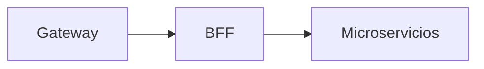

# ms-rutaexpress-bff

## Propósito y arquitectura

Entrada segura sin base de datos. Valida JWT y roles, conserva Bearer y agrega datos de servicios internos.



## Endpoints y roles

`/api/bff/auth/me` (autenticado); dashboard y envíos (cuatro roles); catálogo (Admin/Despachador/Cliente); reportes y status (Admin); auditoría (Admin/Auditor); administración de broker (Admin). Detalle de envío incluye transiciones; timeline permite Admin/Despachador/Auditor. Crear: Admin/Despachador/Cliente; cambiar estado y reintentar: Admin/Despachador.

## Mensajes, idempotencia y DLQ

No produce ni consume RabbitMQ directamente. Solo llama APIs de shipments, catalog y administradores. Los errores de esos servicios conservan código y cuerpo; fallos de conexión se traducen a 503/504.

## Variables de entorno

Comunes: SECURITY_ENABLED, AZURE_AD_ISSUER_URI, AZURE_AD_AUDIENCE y PORT. En nube SECURITY_ENABLED=true. CATALOG_SERVICE_URL, SHIPMENTS_SERVICE_URL, NOTIFY_SERVICE_URL, AUDIT_SERVICE_URL, REPORT_SERVICE_URL, MQ_ADMIN_SERVICE_URL, KAFKA_ADMIN_SERVICE_URL; rutaexpress.http.connect-timeout-ms y read-timeout-ms.

## Construir y probar con Docker

GitHub Actions ejecuta las pruebas dentro de la construcción. No instalar JDK ni Gradle en el PC.

```sh
docker build -t ms-rutaexpress-bff:test ms-rutaexpress-bff
docker build --target reports --output type=local,dest=reports/ms-rutaexpress-bff ms-rutaexpress-bff
```

Las pruebas Testcontainers se ejecutan en un job separado del CI con RUN_DOCKER_TESTS=true; los reportes quedan como artefactos. Pruebas omitidas sin broker no certifican integración.

## Ejecutar con Compose

Configurar infra/.env y ejecutar bash infra/scripts/up.sh en EC2. Ver [infraestructura](../infra/README.md). Las imágenes se descargan de GHCR con etiqueta del commit; no se compila en EC2.

## Decisiones de diseño

El dashboard entrega bloques independientes; audit/report apagados no invalidan los demás datos. GET permite un reintento por conexión. Los cambios no se reintentan automáticamente. status solo publica nombres y UP/DOWN, sin URLs internas.

La aceptación real en nube y las 14 evidencias de la evaluación se verifican por separado del CI.

## Autores

Equipo RutaExpress (Henisaa/Proyecto-cloud-native).
