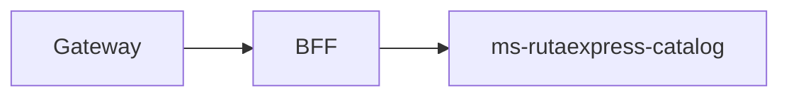

# ms-rutaexpress-catalog

## Propósito y arquitectura

Catálogo de servicios, tarifas y capacidades por zona/vehículo; persistencia Oracle, Flyway y caché.



## Endpoints y roles

`/api/catalog/services`: consultas por los roles autorizados del dominio. Edición, capacidades y tarifas según @PreAuthorize de CatalogViewController; escritura administrativa solo Admin. El BFF restringe la vista de capacidades a Admin/Despachador y permite a Cliente solo servicios.

## Mensajes, idempotencia y DLQ

Consume q.rutaexpress.command desde ex.rutaexpress.cmd (direct): capacity.reserve/release. Produce catalog.capacity.reserved/rejected/released en ex.rutaexpress.events (topic), con eventId commandId:resultado. ACK después del resultado confirmado; errores transitorios reintentan y luego NACK a command.dlq; errores inválidos no reencolan. Reserva única por shipmentId y registro por commandId; liberación usa la línea y paquetes guardados.

## Variables de entorno

Comunes: SECURITY_ENABLED, AZURE_AD_ISSUER_URI, AZURE_AD_AUDIENCE y PORT. En nube SECURITY_ENABLED=true. SPRING_DATASOURCE_URL/USERNAME/PASSWORD; RABBITMQ_ADDRESSES/USERNAME/PASSWORD; RABBIT_PREFETCH, RABBIT_RETRY_MAX_ATTEMPTS, RABBIT_RETRY_INITIAL_MS, RABBIT_DLQ_CONSUMER_ENABLED; KAFKA_ENABLED, KAFKA_BOOTSTRAP_SERVERS.

## Construir y probar con Docker

GitHub Actions ejecuta las pruebas dentro de la construcción. No instalar JDK ni Gradle en el PC.

```sh
docker build -t ms-rutaexpress-catalog:test ms-rutaexpress-catalog
docker build --target reports --output type=local,dest=reports/ms-rutaexpress-catalog ms-rutaexpress-catalog
```

Las pruebas Testcontainers se ejecutan en un job separado del CI con RUN_DOCKER_TESTS=true; los reportes quedan como artefactos. Pruebas omitidas sin broker no certifican integración.

## Ejecutar con Compose

Configurar infra/.env y ejecutar bash infra/scripts/up.sh en EC2. Ver [infraestructura](../infra/README.md). Las imágenes se descargan de GHCR con etiqueta del commit; no se compila en EC2.

## Decisiones de diseño

Una reserva nueva usa persist/INSERT para que la clave única revierta al perdedor de una carrera. Bloqueos de candidatas en orden de id; liberación bloquea la reserva. @Version y bloqueo protegen la edición del máximo, que no puede bajar de lo reservado. Caché invalidada tras commit. Tarifas cargadas por lotes, sin producto cartesiano entre colecciones. La capacidad diaria todavía requiere definir su renovación por fecha (P3-07).

La aceptación real en nube y las 14 evidencias de la evaluación se verifican por separado del CI.

## Autores

Equipo RutaExpress (Henisaa/Proyecto-cloud-native).
