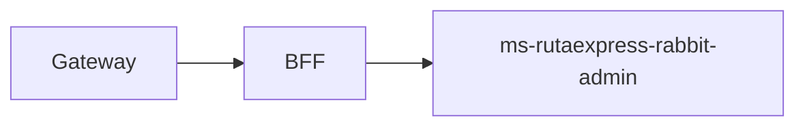

# ms-rutaexpress-rabbit-admin

## Propósito y arquitectura

API de administración de RabbitMQ sin base de datos; lógica encapsulada en RabbitAdminService y monitoreo mediante Management API.



## Endpoints y roles

Prefijo interno `/api/mq-admin`: GET cluster, queues, alerts, metrics, exchanges, bindings, policies; POST queues/exchanges/bindings/topology y exchanges/{name}/messages; DELETE queues/{name}, exchanges/{name}, bindings; PUT retention. Todo exclusivo de Admin. El Gateway publica /api/admin/mq/* y el BFF retransmite.

## Mensajes, idempotencia y DLQ

Declara tres exchanges y tres colas con sus DLQ. Reconciliación al arrancar con reintentos; políticas trabajo (TTL 24 h, 10.000, reject-publish) y DLQ (TTL 7 días, 10.000, drop-head). Publicaciones de prueba usan confirms y mandatory; rechazo por política devuelve 409 y el resultado distingue confirmed/routed.

## Variables de entorno

Comunes: SECURITY_ENABLED, AZURE_AD_ISSUER_URI, AZURE_AD_AUDIENCE y PORT. En nube SECURITY_ENABLED=true. RABBITMQ_ADDRESSES/USERNAME/PASSWORD, RABBITMQ_MANAGEMENT_URLS, RABBITMQ_VHOST; MQ_COMMAND_TTL_MS, MQ_DLQ_TTL_MS, MQ_MAX_LENGTH, MQ_POLL_INTERVAL_MS, MQ_ALERT_THRESHOLD.

## Construir y probar con Docker

GitHub Actions ejecuta las pruebas dentro de la construcción. No instalar JDK ni Gradle en el PC.

```sh
docker build -t ms-rutaexpress-rabbit-admin:test ms-rutaexpress-rabbit-admin
docker build --target reports --output type=local,dest=reports/ms-rutaexpress-rabbit-admin ms-rutaexpress-rabbit-admin
```

Las pruebas Testcontainers se ejecutan en un job separado del CI con RUN_DOCKER_TESTS=true; los reportes quedan como artefactos. Pruebas omitidas sin broker no certifican integración.

## Ejecutar con Compose

Configurar infra/.env y ejecutar bash infra/scripts/up.sh en EC2. Ver [infraestructura](../infra/README.md). Las imágenes se descargan de GHCR con etiqueta del commit; no se compila en EC2.

## Decisiones de diseño

Valida nombres, rangos y existencia del DLX. Borrar recursos protegidos exige force=true; incompatibilidad de argumentos se informa como 409. Métricas incluyen listos, sin confirmar, consumidores, profundidad DLQ, llegados acumulados y tasa. El acumulado depende de estadísticas del nodo y no equivale a una ventana histórica de una hora persistida.

La aceptación real en nube y las 14 evidencias de la evaluación se verifican por separado del CI.

## Autores

Equipo RutaExpress (Henisaa/Proyecto-cloud-native).
