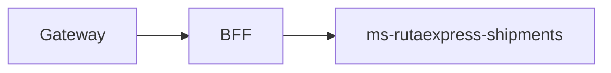

# ms-rutaexpress-shipments

## Propósito y arquitectura

Microservicio principal: persiste envíos en Oracle y coordina capacidad, auditoría y notificaciones asíncronas.



## Endpoints y roles

`/api/shipments` GET y detalle: cuatro roles; Cliente solo propios. POST: Admin/Despachador/Cliente. PUT `/{id}/status` y POST `/{id}/capacity/retry`: Admin/Despachador. GET `/summary`: cuatro roles. GET `/{id}/audit`: Admin/Despachador/Auditor. Listado paginado (máximo 100) y filtros de estado, capacidad, fecha y seguimiento.

## Mensajes, idempotencia y DLQ

Produce capacity.reserve/release en ex.rutaexpress.cmd (direct), shipment.status.* y notification.* en ex.rutaexpress.events (topic). Consume q.rutaexpress.audit (shipment.# y catalog.#). ACK manual tras persistir, reintentos acotados, NACK sin reencolar a q.rutaexpress.audit.dlq, logs y contador. eventId deduplica resultados; lastReserveCommandId descarta reservas anteriores. Liberaciones usan UUID determinista.

## Variables de entorno

Comunes: SECURITY_ENABLED, AZURE_AD_ISSUER_URI, AZURE_AD_AUDIENCE y PORT. En nube SECURITY_ENABLED=true. CATALOGO_ENABLED, CATALOG_SERVICE_URL, NOTIFY_WAREHOUSE_EMAIL, KAFKA_ENABLED y KAFKA_BOOTSTRAP_SERVERS. Oracle: SPRING_DATASOURCE_URL/USERNAME/PASSWORD. Rabbit: RABBITMQ_ADDRESSES/USERNAME/PASSWORD, RABBIT_PREFETCH, RABBIT_RETRY_MAX_ATTEMPTS, RABBIT_RETRY_INITIAL_MS, RABBIT_DLQ_CONSUMER_ENABLED.

## Construir y probar con Docker

GitHub Actions ejecuta las pruebas dentro de la construcción. No instalar JDK ni Gradle en el PC.

```sh
docker build -t ms-rutaexpress-shipments:test ms-rutaexpress-shipments
docker build --target reports --output type=local,dest=reports/ms-rutaexpress-shipments ms-rutaexpress-shipments
```

Las pruebas Testcontainers se ejecutan en un job separado del CI con RUN_DOCKER_TESTS=true; los reportes quedan como artefactos. Pruebas omitidas sin broker no certifican integración.

## Ejecutar con Compose

Configurar infra/.env y ejecutar bash infra/scripts/up.sh en EC2. Ver [infraestructura](../infra/README.md). Las imágenes se descargan de GHCR con etiqueta del commit; no se compila en EC2.

## Decisiones de diseño

Solo RESERVADA o NO_APLICA permiten pasar de ACEPTADO a EN_BODEGA. La reserva es asíncrona, no se espera a catalog. Se reconcilian reservas sin respuesta y cancelados con cupo cada minuto. LIBERACION_PENDIENTE conserva compensaciones pendientes. @Version impide pisar cambios; conflictos devuelven 409. Dueño por oid estable. V2 original, V3 event_id=100, V4 versión/dueño/comando. Kafka se publica después del commit. Outbox sigue pendiente según el plan.

La aceptación real en nube y las 14 evidencias de la evaluación se verifican por separado del CI.

## Autores

Equipo RutaExpress (Henisaa/Proyecto-cloud-native).
